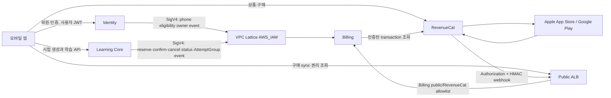
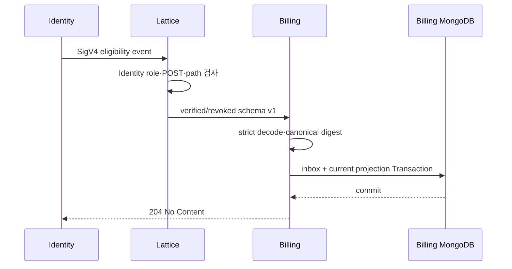
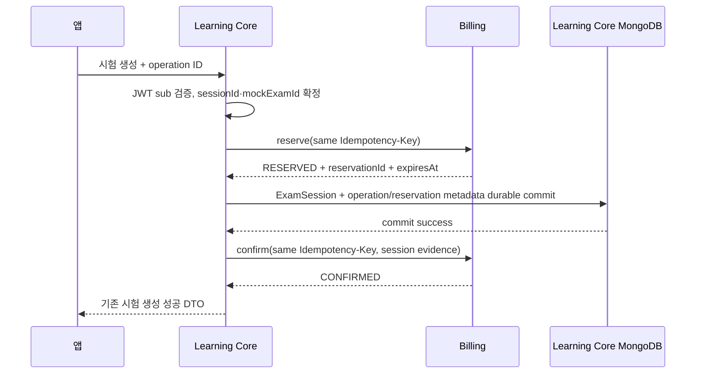

# Billing 서비스 간 연동 계약

> 2026-10-13 최신 단순화 승인: [무료권 정책 §1/3/4](FREE-EXAM-PASS-AND-PAID-SWITCH-RESTORATION-2026-10-13.md) 우선. Billing은 paid confirm·복원 지급·원 그룹 재응시 차단을 같은 Transaction으로 확정하고 LC는 기존 Session을 순차 종료한다. 이미 접수된 무료 제출의 경합 완료와 복원권 동시 보유는 허용한다. 최초 trial consumption ID당 복원 1회, 복원권/초대권 재복원 없음. 현재 무기한·지급순만 구현하고 만료 기능은 후속. MEMBER 전용 보상권의 Guest merge 확장은 제외하며 기존 trial merge는 유지한다. 종전 무중첩 보장·일반 root 계보·현재 만료순 구현·보상권 merge 표현은 이 범위에서 대체한다.

> 2026-10-13 사용자 승인: [공통 무료 모의고사권·유료 전환 복원](FREE-EXAM-PASS-AND-PAID-SWITCH-RESTORATION-2026-10-13.md)을 우선 적용한다. ACTIVE paid로 새 시험을 성공적으로 confirm할 때 미완료 최초 trial 그룹을 종료하고 별도 무료권 1개를 원 lineage당 한 번 복원한다. 구매만으로 지급하지 않으며 원 TrialClaim/consumption은 보존한다. 기존 무료 replacement 우선·새 무료권 미지급 표현은 이 좁은 승인 범위에서 대체한다. 친구 초대는 출처 확장 경계만 준비하며 지급 구현은 후속이다. exact schema/wire·LC 공동 계약·구현/배포는 별도다.

> 2026-10-13 사용자 승인 정책 변경: [환불 전 confirm Session 완료 허용](PAYMENT-CONFIRMED-SESSION-REFUND-POLICY-2026-10-13.md)을 우선 적용한다. 환불 전 confirm된 exact Session은 기존 제출 기한 안에 완료 허용, 환불 선행 confirm 및 신규/재응시는 차단한다. paid 전용 채점 승인 API는 제외하고 durable revoke 전달·구매별 최소 이용 증거는 유지한다. 기존 reserve 응답 출처 추가 방향이며 exact wire/LC 공동 동결은 별도다. 아래 OPEN 제출·채점 차단/GRADING-only 완료·전용 승인 API·v2 필수의 종전 표현은 이 변경 범위에서 역사적 기록으로 대체된다. 코드·LC 저장소·배포는 이번에 변경하지 않았다.


- 작성일: 2026-08-27
- 최종 갱신일: 2026-10-13
- 대상 저장소: `app-back-end-billing`
- 상태: 무료 모의고사 Entitlement와 승인된 fixed-term premium 결제 계약의 통합 안내서
- Jira: 없음

## 1. 문서 목적과 기준

2026-10-13 최신 인증 목표: Identity 기존 JWT 예외와 LC→Billing 여섯 POST의 A 확정 workload JWT 전환은 ADR-002 §20·[B 계획](../plans/PLAN-LC-BILLING-WORKLOAD-JWT.md)을 따른다. 아래 legacy Lattice topology·SigV4-only 설명은 이 범위의 목표에서 대체된다. Billing 문서 동기화와 승인된 B 로컬 수신 구현·HTTP27 회귀는 완료했다. 실제 실환경 전환은 별도다. 다른 방향의 인증과 사용자·업무 계약은 유지한다.

이 문서는 앱, Identity, Learning Core와 Billing이 어떤 책임을 가지며 어떤 요청·event를 주고받는지 한곳에서 설명한다.

이 문서는 연동 흐름을 빠르게 파악하기 위한 상위 안내서다. 세부 wire DTO, 상태 전이, MongoDB와 인프라 계약은 다음 문서가 최종 기준이다.

1. 제품 정책: `docs/codex/CONTRACT_DECISIONS.md`
2. 내부 HTTP·DTO·Mongo 계약: `docs/adr/ADR-001-free-trial-internal-api-and-mongo-contract.md`
3. VPC Lattice·SigV4·환경 격리: `docs/adr/ADR-002-vpc-lattice-ecs-sigv4-and-environment-migration.md`
4. retained trial owner rebind: `docs/adr/ADR-003-retained-trial-owner-rebind-contract.md`
5. fixed-term premium 결제: `docs/contracts/FIXED_TERM_PREMIUM_PAYMENT_CONTRACT.md`
6. 현재 owner rebind 구현 순서: `docs/plans/PLAN-006-retained-trial-owner-rebind.md`

결제 public DTO·RevenueCat adapter·Mongo v5·Learning Core 접근 철회 wire는 [ADR-004 기술 초안](../adr/ADR-004-fixed-term-premium-payment-contract.md)에 작성했다. 4주(28일) 상품·D1-A 정상 만료 중 현재 Session 완료·D2-A 환불 취소 수동 검토는 2026-09-07 승인됐으며, 초안 작성은 상대 서비스 구현·배포 완료를 의미하지 않는다.

이 문서와 ADR이 충돌하면 ADR을 따른다. 계약을 변경할 때는 이 안내서만 고치지 않고 producer와 consumer의 ADR·fixture·contract test를 함께 갱신한다.

2026-10-13 사용자 요청으로 [§16 LC JWT 전환의 공동 활성화·404 보존/복구 절차](#16-lc-jwt-전환의-공동-활성화404-보존복구-절차)를 추가했다. 이 절의 운영 절차 추가는 LC 인증의 exact 규격 동결·구현·배포 승인이 아니다. 현재 승인된 Identity–Billing JWT 단일화 범위와 LC 기존 인증은 유지하며, LC 인증 변경은 ADR/AGENTS·양측 fixture를 별도로 동기화한다. §12의 기존 Lattice/SigV4 배포 순서를 JWT 전환에 그대로 사용하지 않고 §16의 수신 준비 선행 조건을 적용한다.

## 2. 서비스별 책임

2026-09-07 승인·구현: 결제보다 먼저 [PLAN-007 무료 사용권 reader](../plans/PLAN-007-public-free-entitlement-query.md)의 `GET /api/v1/entitlements`를 사용자 JWT/Billing audience/billing:read로 제공한다. Guest·MEMBER 본인만 조회하며, 수량·진행·재응시를 구분한다. 이 API의 public `isSuccess/code/message/result` envelope는 internal DTO에 적용하지 않는다. Billing 구현·로컬 테스트는 완료했고 reader는 기본 OFF다. Identity PR #39 account_type 병합과 aud/read 후속 발급·운영 배포를 혼동하지 않는다. [배포·legacy 이관 gate](../runbooks/PLAN-007-public-reader-rollout.md) 이후 활성화한다. 아래 payments 흐름은 후속 결제 계획이고 이번 무료 조회에 함께 구현하지 않는다.

| 주체 | 소유하는 것 | Billing 연동 책임 |
| --- | --- | --- |
| 앱 | 사용자 동작과 사용자 Access Token | 시험 시작 operation ID를 보존하고 RevenueCat purchase 뒤 Billing sync를 재시도 |
| Identity | 계정, verified phone, 사용자 JWT | phone eligibility event와 Billing audience·account-type별 scope 발급 |
| Learning Core | 시험 Session, 문제, 제출, 채점, 결과 | reserve/confirm/cancel·상태 event와 refund access-revocation projection 적용 |
| RevenueCat | Apple/Google purchase SDK·Offering, Store transaction 정규화와 webhook | `purchaseAccountRefId`로 구매를 연결하고 Billing에 Authorization+HMAC event/API 조회 제공 |
| Billing | TrialClaim, paid purchase·entitlement·ledger, Reservation, AttemptGroup projection | RevenueCat에서 검증한 Store transaction으로 권리 승인·환불·expiry·reconciliation과 revoke event 수행 |

Billing은 사용자 계정, phone 원문, 시험 문제, 음성, AI 채점 결과를 소유하지 않는다. Identity는 무료권을 지급하지 않고 Learning Core는 entitlement balance를 직접 계산하지 않는다.

## 3. 전체 통신 구조



무료-only 단계에는 앱이 Billing을 직접 호출하지 않았으나 fixed-term 결제부터 기존 public ALB의 Billing 전용 host/path·target group을 통해 구매 sync·권리 조회를 직접 호출한다. public route는 `GET /api/v1/payments/products`, `POST /api/v1/payments/purchase-account`, `POST /api/v1/payments/sync`, 권리 조회는 기존 `GET /api/v1/entitlements`를 무료·유료 통합으로 확장한다. 유료 전용 `/api/v1/payments/entitlement`는 신설하지 않는다. 상품·구매 UI는 RevenueCat SDK·Offering을 사용하고, RevenueCat Authorization+HMAC webhook만 별도 public provider route로 허용한다. internal route는 계속 Lattice-only다.

RevenueCat은 같은 project의 iOS/Android app을 사용하되 webhook integration을 SANDBOX→staging, PRODUCTION→production으로 filter하고 URL·Authorization·HMAC secret을 환경별로 분리한다. webhook은 5분 HMAC timestamp window와 raw-body 검증 뒤 durable inbox를 commit하고 200을 반환하며 worker가 처리한다. S2S-only 신규 purchase 추적과 자동 refund handling은 최초 출시에서 OFF다.

Billing도 현재 계약에서는 Identity나 Learning Core를 동기 호출하지 않는다. Identity와 Learning Core가 Billing으로 push하고, Learning Core는 Billing status를 조회해 불명확한 command를 복구한다.

## 4. 공통 전송·인증 계약

### 4.1 운영 통신

- Identity와 Learning Core는 ECS application task role의 임시 credential을 사용한다.
- 요청은 SigV4 service `vpc-lattice-svcs`, region `ap-northeast-2`로 서명한다.
- VPC Lattice Billing service는 `AWS_IAM` auth policy로 principal, HTTP Method와 Path를 함께 검사한다.
- Identity role은 Trial eligibility와 승인된 owner rebind event route만 호출할 수 있다.
- Learning Core role은 Reservation, status와 AttemptGroup event route만 호출할 수 있다.
- unsigned 요청, 잘못된 role, 반대 환경 role, 권한 없는 route와 Billing task 직접 접근은 거절한다.
- public ALB, shared API key, caller가 임의로 넣은 identity header 또는 사용자 Access Token forwarding을 내부 workload 인증으로 사용하지 않는다. public ALB는 결제 사용자/RevenueCat webhook route에만 사용하고 `/internal/**`를 Billing target으로 전달하지 않는다.

### 4.2 환경 격리

- production과 staging은 Lattice service network, ECS task role, security group, database와 Secret을 분리한다.
- production role은 staging Billing을, staging role은 production Billing을 호출할 수 없다.
- Billing task는 private subnet에 두고 Lattice managed prefix 경로 외 TCP 8082 직접 접근을 차단한다.
- 실제 role ARN, VPC·subnet·SG·Lattice ID와 DNS는 배포 환경 inventory로 주입하고 저장소에 하드코딩하지 않는다.

### 4.3 HTTP 공통 규칙

- 내부 API prefix는 `/internal/v1`이다.
- `Content-Type`은 `application/json`이다.
- request/response body 상한은 16 KiB다.
- redirect는 허용하지 않는다.
- internal API는 앱용 `BaseResponse`를 사용하지 않는다.
- breaking change는 `/internal/v2`로 올린다.
- v1 optional field는 consumer reader-first 배포 후 producer가 전송한다.
- timeout이나 connection reset은 server commit 여부가 불명확하다는 뜻이므로 새로운 key/event를 만들지 않고 같은 값으로 재시도한다.

### 4.4 식별자 경계

| 값 | 생성·소유 | 전달 규칙 |
| --- | --- | --- |
| `userId` | Identity | lowercase canonical UUID; 인증된 Identity 또는 Learning Core route에서만 수신 |
| `eventId` | event producer | lowercase UUID v4; at-least-once delivery 멱등성 식별자 |
| `operationId` | 앱 | lowercase UUID v4; Billing command에서는 `Idempotency-Key` header가 유일한 source |
| `sessionId` | Learning Core | 기존 `examId`; 1~128자 opaque token |
| `mockExamId` | Learning Core | 1~128자 opaque token; AttemptGroup 동안 고정 |
| `reservationId` | Billing | lowercase UUID v4 |
| `attemptGroupId` | Billing | lowercase UUID v4 |

앱이나 public path가 보낸 `userId`는 신뢰하지 않는다. Learning Core는 사용자 JWT `sub`를 검증한 뒤 그 UUID를 내부 Billing 요청에 전달한다. Identity eligibility event의 `userId`도 인증된 Identity role에서만 신뢰한다.

## 5. Identity → Billing: Trial eligibility 동기화

### 5.1 목적

Identity는 verified phone 원문을 보내지 않는다. Billing이 같은 benefit scope 안에서 무료시험 중복 여부를 판단할 수 있도록 consumer-scoped candidate와 최신 binding 상태만 전달한다.

event 수신은 무료권 지급이 아니다. Billing은 event를 받았다는 이유만으로 TrialClaim, grant, ledger, Reservation 또는 balance를 만들지 않는다.

### 5.2 endpoint와 principal

```http
POST /internal/v1/eligibility/trial/events
```

- 허용 principal: 같은 환경의 Identity ECS task role
- 금지 principal: Learning Core role, 사용자 JWT, deploy role, unsigned caller

### 5.3 event 종류

| eventType | 의미 | candidate 처리 |
| --- | --- | --- |
| `PhoneEligibilityBindingVerified` | 사용자의 verified phone binding 최신 상태 | retained candidate 완전체로 교체 |
| `PhoneEligibilityBindingRevoked` | binding 철회·해제 최신 상태 | candidate 제거, revision tombstone 유지 |

schema v1 공통 필드는 `eventId`, `eventType`, `schemaVersion`, `producer`, `occurredAt`, `consumerScopeId`, `userId`, `bindingRevision`이다. verified event는 `verifiedAt`과 `fingerprintCandidates`, revoked event는 `revokedAt`을 가진다.

Billing은 다음을 strict validation한다.

- exact `schemaVersion=1`, `producer=identity`와 승인된 event type
- 환경 설정의 expected `consumerScopeId` exact match
- lowercase canonical UUID, timestamp와 revision 범위
- verified/revoked 전용 field 상호배타
- candidate 개수, keyVersion, Base64URL value 형식과 중복
- duplicate field, unknown field, trailing token과 scalar coercion 금지

### 5.4 멱등성·순서 처리

Billing은 검증된 event를 canonical JSON으로 정규화하고 SHA-256 digest를 계산한다. raw payload는 저장하지 않는다.

| 조건 | 처리 | HTTP |
| --- | --- | --- |
| 처음 보는 정상 최신 event | inbox APPLIED + current projection 갱신 | 204 |
| 같은 eventId·같은 digest | duplicate no-op | 204 |
| 낮은 bindingRevision | inbox STALE, projection 유지 | 204 |
| revision gap이 있는 더 최신 event | 최신 complete state 적용 + 제한된 metric | 204 |
| 같은 eventId·다른 digest | 기존 기록 유지, conflict | 409 |
| 다른 eventId·같은 scope/user/revision | 기존 기록 유지, conflict | 409 |
| malformed·oversize | 저장하지 않음 | 400 |
| unknown schema/event/producer/scope | 저장하지 않음 | 422 |
| Transaction 일시 장애 | 전체 rollback 또는 commit 재확인 | 503 |

`inbound_event_inbox`와 `trial_eligibility`는 하나의 Mongo Transaction에서 반영한다. Billing은 local commit이 완료됐거나 같은 digest의 기존 commit을 확인한 뒤에만 204를 반환한다.

### 5.5 delivery와 재시도

- Identity delivery는 at-least-once다.
- timeout, 429와 5xx는 같은 eventId와 같은 payload로 재시도한다.
- 429와 503에 유효한 정수 초 `Retry-After`가 있으면 Identity는 자체 backoff보다 이른 시각에 재시도하지 않는다. 비정상·과도한 값의 허용 범위는 Identity 구현 계약에서 제한한다.
- 204는 applied, duplicate 또는 stale을 모두 포함하는 성공 수렴이다.
- eligibility endpoint의 409는 `EVENT_ID_CONFLICT` 전용이다. `COMMAND_PROCESSING`은 Reservation command에만 사용한다.
- 400·409·422는 자동으로 새 eventId를 만들어 우회하지 않고 producer 운영 절차에 따라 격리·조사한다.
- 인증 실패는 payload 문제로 취급하지 않고 role·Lattice policy·환경 설정을 수정한다.

### 5.6 owner rebind delivery·IAM·cleanup

- Identity는 immutable owner-rebind event core와 `(eventId, consumer)` unique delivery를 사용한다. `UserMerged` required consumer는 `BILLING`, `LEARNING_CORE`, `TrialOwnerRebindApproved`는 `BILLING`뿐이다.
- event core와 lifecycle별 필수 delivery는 Identity lifecycle Transaction에서 원자 저장하고 delivery별 lease·retry·dead-letter·published와 feature flag를 독립 관리한다.
- phone 재가입은 `TrialOwnerRebindApproved`를 `POST /internal/v1/eligibility/trial/owner/events`, Guest merge `UserMerged` v1은 `POST /internal/v1/owners/merge/events`로 전달한다.
- phone event는 Learning Core에 전달하지 않는다. Identity→Billing은 Lattice SigV4, Identity→Learning Core `UserMerged`는 기존 workload JWT를 유지한다.
- Billing Lattice auth policy는 Identity task role의 `vpc-lattice-svcs:Invoke`, POST와 위 route 및 기존 `/internal/v1/eligibility/trial/events`만 허용한다.
- active Reservation/processing/prerequisite pending은 503 `OWNER_REBIND_PENDING`과 승인된 delta-seconds `Retry-After`로 재시도한다.
- phone AttemptGroup 없음/OPEN/RETAKE_AVAILABLE은 owner 이전, GRADING은 pending, COMPLETED는 owner/fence 불변 NOOP다.
- target 재응시는 기존 group·consumption·mockExamId를 재사용하되 source Session을 이전하지 않고 새 examId로 처음부터 시작한다.
- Learning Core에 기존 Session이 없는 phone target은 `POST /internal/v1/reservations/continuations/phone`에 target `userId`만 보내 Billing authoritative `continuationReason=PHONE_REJOIN`, `continuationId`, `attemptGroupId`, `mockExamId`를 먼저 조회한다. 대상이 없으면 204다.
- phone reserve는 위 context의 `continuationReason`, `continuationId`, `expectedAttemptGroupId`를 모두 echo한다. Billing은 current owner transition과 group/mock을 재검증하고 명시적인 phone REPLACEMENT로 응답한다.
- related Session terminal 뒤 24시간 안에 legacy sourceUserId를 unset한다. terminal 미수렴 hard upper bound는 `min(rebindAppliedAt+120일, TrialClaim.retentionExpiresAt)`이다.
- hard cap 뒤 late source event는 자동 owner authorization에 사용하지 않고 privileged reconciliation 대상으로 분류한다.



## 6. Learning Core → Billing: 시험 생성 Reservation

### 6.1 앱에서 Billing까지 operation 전달

공개 시험 생성 계약은 다음과 같다.

```http
POST /api/v1/exams
Idempotency-Key: <lowercase UUID v4>
```

Request Body 없음과 기존 성공 Response DTO는 유지하며 `Idempotency-Key` header는 필수다.

1. 앱은 시험 시작 동작마다 UUID v4 `operationId`를 만들고 결과가 확정될 때까지 보존한다.
2. 앱은 Learning Core 시험 생성 요청의 `Idempotency-Key` header로 이 값을 보내며 transport retry에는 같은 값을 사용한다.
3. Learning Core는 사용자 JWT `sub`에서 `userId`를 확정하고 `sessionId`와 `mockExamId`를 준비한다.
4. Learning Core는 같은 operation ID를 Billing `Idempotency-Key`로 사용한다.

Billing은 앱 Access Token을 받거나 검증하지 않는다. Billing이 신뢰하는 caller는 Lattice가 인증한 Learning Core task role이다.

### 6.2 API 목록

| 목적 | Method·Path | 멱등성 |
| --- | --- | --- |
| entitlement hold | `POST /internal/v1/reservations` | `Idempotency-Key=<operationId>` |
| Session commit 후 소비 확정 | `POST /internal/v1/reservations/{reservationId}/confirm` | reserve와 같은 key |
| Session commit 실패 후 hold 해제 | `POST /internal/v1/reservations/{reservationId}/cancel` | reserve와 같은 key |
| operation 상태 확인 | `POST /internal/v1/reservations/status` | read-only; 새 command를 만들지 않음 |

status를 POST body로 조회하는 이유는 `userId`와 operation ID가 URL과 access log에 남는 것을 줄이기 위해서다.

### 6.3 정상 시험 생성 흐름



앱에 성공을 반환하는 시점은 Session commit과 Billing confirm이 모두 확정된 뒤다. 기존 Learning Core 공개 시험 생성 Request Body와 성공 Response DTO는 유지한다.

### 6.4 앱 종료·restart와 transport retry 구분

- 시험 생성 HTTP 응답을 받지 못한 transport retry는 같은 key를 사용해 같은 Session 결과로 수렴한다.
- 사용자가 앱을 종료한 뒤 다시 시험을 시작하는 의도적 restart는 새 `Idempotency-Key`와 새 `examId`를 사용한다.
- 기존 미완료 Session은 `ABANDONED_RESTARTED`로 닫고 새 Session에서 처음부터 시작한다.
- 기존 결과·upload·grading Job·summary를 새 Session에 복사하지 않는다.
- 이전 Session의 늦은 Callback은 새 Session에 저장하지 않고 abandoned fencing에 따라 no-op 처리한다.
- replacement Session은 기존 AttemptGroup consumption을 재사용하고 같은 `mockExamId`를 유지한다.

이 규칙에서 key는 한 번의 Session 생성 command를 식별한다. 무료 replacement entitlement와 transport retry를 같은 의미로 취급하지 않는다.

### 6.5 reserve

reserve는 아직 durable하지 않은 proposed `sessionId`, 고정할 `mockExamId`와 검증된 `userId`를 받는다.

- 새 non-terminal AttemptGroup이 없으면 `INITIAL`이다.
- 최초 INITIAL reserve Transaction에서만 현재 verified binding과 기존 TrialClaim을 확인하고, 필요하면 TrialClaim·free grant를 생성해 1 unit을 hold한다.
- 기존 `OPEN` 또는 `RETAKE_AVAILABLE` group을 이어가는 새 Session이면 `REPLACEMENT`다.
- REPLACEMENT는 기존 consumption을 재사용하고 추가 grant allocation을 만들지 않는다.
- `GRADING` group에는 새 Session을 즉시 허용하지 않고 processing conflict를 반환한다.
- 같은 operation·같은 canonical payload는 기존 Reservation 결과를 반환한다.
- 같은 operation을 다른 payload로 사용하면 409 `IDEMPOTENCY_KEY_CONFLICT`다.
- 일반 요청은 기존 세 field만 사용한다. phone continuation 요청만 `continuationReason=PHONE_REJOIN`, `continuationId`, `expectedAttemptGroupId`를 모두 추가하며 일부 field, 잘못된 owner epoch/group/mock은 거절한다.
- phone 성공 응답과 status는 optional `continuationReason`, `continuationId`를 포함하고 기존 AttemptGroup의 attemptGroupId/mockExamId를 authoritative하게 반환한다. 일반 응답에는 optional field를 생략한다.

`RESERVED`의 기본 expiry는 5분이다. 이 시간은 사용자 대기시간이 아니라 Session commit 실패 시 hold가 영원히 남지 않게 하는 안전장치다.

### 6.6 confirm

- Learning Core Session이 durable commit된 뒤에만 호출한다.
- stored userId, operation ID와 sessionId가 모두 같아야 한다.
- INITIAL은 allocation을 consume하고 ledger와 AttemptGroup `OPEN`을 만든다.
- REPLACEMENT는 추가 소비 없이 active Session projection만 새 Session으로 연결한다.
- 같은 payload의 재호출은 기존 confirmed 결과를 반환한다.
- CANCELED 또는 EXPIRED Reservation은 일반 confirm으로 복구하지 않는다.
- privileged repair-confirm은 별도 계약과 운영 role 승인 전까지 열지 않는다.

### 6.7 cancel과 expiry

Learning Core Session commit이 실패하면 cancel한다.

- INITIAL cancel은 held allocation을 원 grant로 복원하고 release ledger를 남긴다.
- REPLACEMENT cancel은 기존 consumption을 바꾸지 않는다.
- cancel이나 expiry는 TrialClaim을 삭제하거나 `claimedAt`을 갱신하지 않는다.
- CONFIRMED Reservation은 cancel하거나 expiry시키지 않는다.
- reaper는 `expiresAt`을 지난 `RESERVED`만 명시적으로 `EXPIRED`로 전환한다.
- Reservation·ledger audit document는 Mongo TTL로 삭제하지 않는다.

### 6.8 confirm 응답 유실과 reconciliation

confirm timeout은 성공·실패 중 어느 쪽도 단정하지 않는다.

1. Learning Core는 같은 operation ID로 confirm을 재시도하거나 status를 조회한다.
2. Billing status가 CONFIRMED면 기존 Session을 정상 노출한다.
3. RESERVED면 같은 key로 confirm을 재시도한다.
4. CANCELED·EXPIRED면 자동 repair-confirm하지 않고 reconciliation·운영 정책으로 보낸다.
5. operation을 찾을 수 없으면 Learning Core가 Session과 command 증거를 기준으로 복구 판단한다.

Learning Core는 confirm 결과가 불명확한 Session을 성공으로 먼저 노출하거나 새 operation으로 이중 reserve하지 않는다.

## 7. Learning Core → Billing: AttemptGroup 상태 event

```http
POST /internal/v1/attempt-group-events
```

Learning Core는 시험 문제나 AI 결과 원문을 보내지 않고 Billing consumption 상태에 필요한 최소 증거만 push한다.

| targetStatus | 의미 | 필수 정보 |
| --- | --- | --- |
| `GRADING` | 필수 제출이 접수되고 결과 생성 중 | current active Session fencing |
| `COMPLETED` | 사용자에게 필수 결과가 조회 가능 | feedback·valid score·summary evidence 모두 true |
| `RETAKE_AVAILABLE` | 최종 실패로 같은 consumption 재응시 가능 | 제한된 failureCode; provider 원문 금지 |

- event는 `eventId`와 canonical digest로 멱등 처리한다.
- same eventId·same digest는 204 no-op, 다른 digest는 409다.
- abandoned 또는 stale Session event는 active Session fencing에 실패하면 204 stale no-op다.
- Billing은 Learning Core Session·문제·AI 결과 document를 복제하지 않는다.
- `RETAKE_AVAILABLE.failureCode`는 `REQUIRED_RESULTS_UNAVAILABLE`, `SUMMARY_UNAVAILABLE`, `GRADING_DEADLINE_EXCEEDED`, `RESULT_INTEGRITY_VIOLATION`만 허용한다.
- event revision 없이 group `activeSessionId`, AttemptSession `ACTIVE`, 단방향 transition과 Mongo CAS로 수렴한다. terminal evidence의 역순 도착을 위해 OPEN에서 COMPLETED/RETAKE_AVAILABLE 직접 전진을 허용하되 Learning Core는 Session당 COMPLETED 또는 RETAKE_AVAILABLE terminal event 하나만 Transaction/CAS로 생성한다.
- 정상 순서상 projection 미준비는 503 `ATTEMPT_PROJECTION_NOT_READY`와 `Retry-After: 5`, stale Session은 204, 존재하는 관계 충돌은 409 `EVENT_TARGET_CONFLICT`다.
- Learning Core PENDING outbox는 전달 전 TTL 삭제하지 않고 network/408/425/429/5xx를 5초, 15초, 1분, 5분, 15분 뒤 최대 15분+jitter로 재시도한다. DELIVERED는 30일, DEAD_LETTER는 90일 보존한다.
- W3C `traceparent`를 HTTP header로 전달하고 양쪽 구조화 로그에 `service`, `operation`, `outcome`, `traceId`, `eventId`, `durationMs`를 기록한다. Billing consume은 event 생성부터 수신까지 `eventAgeMs`도 기록한다.
- `service`는 `learning-core`/`billing`, operation과 outcome은 승인된 low-cardinality 값만 사용한다. `durationMs`는 해당 publish/consume 단계의 monotonic elapsed time이고 `eventAgeMs=max(0, consumeNow-occurredAt)`는 outbox 대기·retry를 포함한 전달 지연이다.
- trace context는 JSON/digest/business key가 아니며 baggage, 사용자·Session·AttemptGroup 식별자와 provider 원문은 trace attribute에 넣지 않는다. traceId/eventId/durationMs/eventAgeMs는 metric label로 사용하지 않는다.

## 8. 공통 오류·재시도 규칙

| HTTP | code·종류 | caller 동작 |
| --- | --- | --- |
| 204 | event 처리 성공 | 재시도 종료 |
| 200 | command 최초·replay 성공 | 기존 결과 사용 |
| 400 | `INVALID_REQUEST`, `INVALID_IDEMPOTENCY_KEY` | payload/key 수정; 자동 재시도 금지 |
| 401/403 | Lattice/IAM security response | role·서명·route 설정 수정 |
| 402 | `ENTITLEMENT_INSUFFICIENT` | 무료 entitlement 없음; 자동 재시도 금지 |
| 404 | `OPERATION_NOT_FOUND` | Learning Core reconciliation 판단 |
| 409 | `COMMAND_PROCESSING` | `Retry-After` 후 같은 key 재시도 |
| 409 | `IDEMPOTENCY_KEY_CONFLICT`, `EVENT_ID_CONFLICT` | 자동 우회 금지; 격리·조사 |
| 409 | `EVENT_TARGET_CONFLICT` | 자동 재시도 금지; 관계 충돌 격리·조사 |
| 409 | `RESERVATION_STATE_CONFLICT` | status 조회 후 복구 판단 |
| 422 | `UNSUPPORTED_CONTRACT` | consumer reader 배포·설정 확인 |
| 429 | `RATE_LIMITED` | `Retry-After` 후 같은 event/key 재시도 |
| 503 | `ATTEMPT_PROJECTION_NOT_READY` | `Retry-After: 5` 후 같은 event 재시도 |
| 503 | `BILLING_TEMPORARILY_UNAVAILABLE` | 같은 event/key로 backoff+jitter 재시도 |

processing, 429와 503에는 정수 초 `Retry-After`를 사용한다. retryable 오류에서도 새로운 eventId, operation ID나 Session을 만들지 않는다.

내부 error envelope에는 stable `code`, 안전한 `message`, `retryable`, 비식별 `correlationId`만 둔다. candidate, userId, balance, reservation/payment 식별자, provider 원문, exception과 stack trace를 노출하지 않는다.

## 9. 데이터·개인정보 경계

Billing에 저장하지 않는 값:

- raw phone, last4, 전화번호 암호문
- Firebase UID, provider subject와 Identity phone fingerprint
- HMAC key material
- 사용자 Access Token, SigV4 Authorization와 AWS session token
- 시험 음성, transcript, 문제, AI/provider 결과 원문
- Apple/Google receipt·notification과 RevenueCat webhook 원문

Billing이 무료 MVP에 저장하는 핵심 값:

- eligibility event inbox와 current binding projection
- benefit-scoped candidate와 keyVersion
- TrialClaim, 삭제 가능한 subject link와 candidate alias
- entitlement grant·allocation·ledger
- Reservation, idempotency command와 AttemptGroup consumption projection

candidate, userId, payload digest와 eventId를 metric tag로 사용하지 않는다. request/response payload 전체를 로그에 남기지 않는다.

## 10. TrialClaim 보존과 owner 변경

- TrialClaim은 최초 `claimedAt`부터 3년 동안 같은 benefit-scoped candidate의 재수급을 막는다.
- 탈퇴·재가입·merge·binding revoke·cancel·Reservation expiry로 `claimedAt`을 갱신하거나 Claim을 다시 열지 않는다.
- 3년 동안 번호가 재할당돼도 기존 Claim을 유지한다.
- `retentionExpiresAt`부터 만료 candidate alias는 dedupe에서 즉시 제외한다.
- daily purge는 logical expiry 후 24시간 안에 candidate, keyVersion, user와 source event 연결을 active DB에서 제거한다.
- backup은 최대 35일이며 복구본을 서비스에 연결하기 전에 현재 시각 기준 expiry purge를 실행한다.
- 3년 뒤 같은 번호가 다시 verified되면 새 Claim을 허용한다.

Identity user merge가 발생해도 Billing은 Claim의 candidate 중복 방지 기록을 삭제하지 않고 entitlement owner mapping만 승인된 owner-transfer Transaction으로 변경한다. 구체적인 `UserMerged`/phone rejoin consumer wire, Mongo v4, fencing과 cleanup은 `ADR-003-retained-trial-owner-rebind-contract.md`를 따른다.

## 11. local·test 계약

- local/test는 실제 AWS credential이나 VPC Lattice를 호출하지 않는다.
- 기본 internal ingress mode는 disabled이며 `/internal/**`를 deny한다.
- contract/MVC test만 명시적인 test workload principal로 endpoint를 활성화한다.
- Repository fake를 사용하는 단위·MVC test와 replica-set Testcontainers 통합 테스트를 분리한다.
- Mongo Transaction·unique index·동시성은 standalone Mongo로 검증했다고 간주하지 않는다.
- Identity와 Learning Core producer fixture를 사용하되 두 서비스의 domain class를 Billing으로 복사하지 않는다.

## 12. 배포와 활성화 순서

1. Billing strict consumer와 local contract test 구현
2. Mongo replica set·명시적 index·Transaction 검증
3. 환경별 Billing Lattice service, auth policy, ECS task role과 SG 준비
4. Billing endpoint를 default deny 상태로 배포
5. Identity caller role·SigV4 client와 eligibility publisher endpoint 설정
6. staging에서 허용 role 성공, unsigned·wrong role·wrong route·direct task 실패 검증
7. eligibility event replay·중복·역순·장애 E2E 검증
8. TrialClaim·grant·Reservation 구현 후 Learning Core SigV4 client와 Session saga 연결
9. same-key retry, Session commit 실패, confirm 응답 유실과 5분 expiry E2E 검증
10. reconciliation·metric·alert와 rollback gate 통과 후 production 활성화

Identity producer나 Learning Core 시험 생성 gate를 Billing consumer보다 먼저 활성화하지 않는다. Billing 장애 시 무료 중복 방지 확인을 우회하는 fail-open도 허용하지 않는다.

## 13. 변경 절차

서비스 간 계약 변경은 다음 순서로 진행한다.

1. 변경 소유 서비스와 영향을 받는 consumer를 식별한다.
2. backward-compatible field 추가인지 breaking change인지 판정한다.
3. ADR과 이 통합 안내서를 갱신한다.
4. consumer decoder와 contract fixture를 reader-first로 배포한다.
5. producer가 새 field/version을 전송한다.
6. 양쪽 contract test와 staging positive/negative E2E를 통과한다.
7. 구 계약 제거가 필요하면 별도 migration·보존 기간 후 제거한다.

다음 변경은 명시적인 공동 승인 없이 수행하지 않는다.

- Identity event type, schemaVersion, field명·타입·의미 변경
- `userId`, `operationId`, `sessionId` 의미 변경
- `Idempotency-Key` source 변경
- route·Method·success/error mapping 변경
- SigV4 service/region, principal과 route authorization 변경
- TrialClaim 보존·재수급 정책 변경
- Learning Core 공개 시험 API Request/Response 변경

## 14. 현재 구현 상태

- Identity의 phone eligibility outbox·publisher는 구현돼 있다.
- Billing의 Trial eligibility consumer, FREE_EXAM_ONCE BenefitDefinition/Claim·Grant, Reservation lifecycle와 AttemptGroup status consumer는 구현돼 있다.
- Billing TMI-120 브랜치에는 schema v4 reader-first owner CAS, phone/Guest strict consumer, active Reservation pending, exact legacy Session fence와 개인정보 cleanup worker가 구현돼 있다. production owner rebind flag는 기본 false다.
- Learning Core의 Billing reserve saga와 AttemptGroup status publisher는 구현돼 있다. `UserMerged` owner migration/source deny와 phone target의 기존 group replacement 수용은 별도 후속 검증 대상이다.
- VPC Lattice, Billing ECS service와 실제 IAM/SG 리소스는 아직 없다.
- Identity event별 owner delivery, Learning Core `UserMerged` consumer와 phone replacement staging E2E가 끝나기 전에는 production owner rebind를 활성화하지 않는다.
- 무료/owner lifecycle 핵심 코드는 구현됐고 Apple Consumable In-App Purchase·Google consumable one-time product와 RevenueCat 표준 SDK/Authorization+HMAC webhook/API 기반 fixed-term 결제는 제품·ADR-004 선택 승인, exact ADR/PLAN 보완 대기 상태다. 2026-10-06 Store 부분 환불 결과의 실제 반환액 기록·해당 구매 잔여권 종료 및 구매별 최소 이용 증거 연결은 설계 범위에 포함됐다(ADR-004 §5.8.1). Identity REFUND 문의·팀 검토·2영업일 1차 답변은 운영 방향이며 타 서버 구현 완료를 뜻하지 않는다. paid credit, fixed-unit exam pass, 자동 갱신, coupon·자동 환불 심사/공제액 산정·직접 송금은 범위 밖이다.

## 15. 연동 점검 체크리스트

Identity 연동:

- Identity role만 Trial route를 호출할 수 있는가
- expected `consumerScopeId`가 환경별로 일치하는가
- same event replay가 204 no-op인가
- stale/revision gap/conflict가 계약대로 수렴하는가
- raw phone과 payload 원문이 전달·로그·저장되지 않는가

Learning Core 연동:

- JWT `sub`에서 확정한 userId만 내부 요청에 보내는가
- 앱 재시도부터 Billing까지 같은 operation ID를 유지하는가
- Session commit 전에 reserve, commit 뒤 confirm 순서를 지키는가
- commit 실패 시 cancel하고 confirm 불명 시 status/retry로 수렴하는가
- Billing confirm 전 앱에 시험 생성 성공을 반환하지 않는가
- REPLACEMENT가 추가 차감 없이 같은 AttemptGroup·mockExamId를 유지하는가

보안·운영:

- production/staging role과 Lattice service가 분리됐는가
- unsigned·wrong role·wrong route·direct task 접근이 실패하는가
- retry가 새 eventId·operation ID·Session을 만들지 않는가
- metric·log·error에 candidate, userId, credential과 payload 원문이 없는가
- Billing 미확인 상태를 fail-open으로 우회하지 않는가

## 16. LC JWT 전환의 공동 활성화·404 보존/복구 절차

- 추가일: 2026-10-13 / 근거: 사용자 공동 계약 추가 요청, [Billing 검토·회신](LC-BILLING-WORKLOAD-JWT-REVIEW-2026-10-13.md).
- 검토 revision: **LC-JWT-TRANSITION-R2** — 빈 ingress404와 업무 OPERATION_NOT_FOUND 분리, 재처리 도구 미준비 명시, §16.6 동결 목록 추가.
- LC 검토 회신 접수(2026-10-13): 사용자 전달 회신에서 R2 §16.3 오류 구분과 §16.5 도구 미준비 명시를 적절하다고 검토했고 추가 문구 수정 의견이 없음을 확인했다. 문구 검토 완료 범위는 이 두 항목이며 §16.6 인증 exact 규격·양측 구현 범위는 공동 확정 대기다. 구현·배포·활성화 승인이 아니다. 전달한 R2 스냅샷은 당시 검토본으로 보존한다.
- 상태: 공동 검토/동결을 위한 전환 절차 추가. 아래 보존·복구 원칙을 계획·검증에 적용하며, LC 코드의 독립 확인·양측 exact 인증 수락·실제 활성화는 별도 완료 증거가 필요하다.

### 16.1 인증 방향과 적용 범위

권장 방향은 RS256·TTL 최대60초·초기 배포형 공개키·목적/환경별 단일 audience·body 없는401/403이다. 기존 workload TLS connector를 공유할 수 있으나 LC/Identity 키·issuer·principal·인가·수신 활성화 설정은 독립이어야 한다. exact issuer/audience 문자열·설정 이름·시간/오류 precedence는 양측 fixture로 동결한다. 동적 JWKS나 새 인증 오류 JSON을 이번 절에서 추가하지 않는다.

A 단계의 exact 인증·공동 테스트 명세는 [LC-BILLING-WORKLOAD-AUTH-R1.md](LC-BILLING-WORKLOAD-AUTH-R1.md)를 따른다. 2026-10-13 LC 최종 수락을 Billing 정본에 반영했으며 인증 규칙·fixtures-1 hash·발신 설정 명칭과 양측 token/hash 독립 검증은 완료됐다. [최종 수락 기록](LC-BILLING-WORKLOAD-A-ACCEPTANCE-R1.md)을 따른다. LC startup 표 수락·양측 문서 동기화와 LC sender 회신/Billing B 로컬 수신·HTTP27 검증은 완료됐다. [Billing 검증 결과](LC-BILLING-WORKLOAD-JWT-B-BILLING-VALIDATION-2026-10-13.md)를 따르며 C 도구·실환경 연결·배포는 남아 있다.

대상은 LC→Billing의 다음 여섯 POST 업무 route다. 기존 body/성공 DTO/업무 오류·멱등성·상태 머신을 변경하지 않는다.

- `/internal/v1/reservations`
- `/internal/v1/reservations/{reservationId}/confirm`
- `/internal/v1/reservations/{reservationId}/cancel`
- `/internal/v1/reservations/status`
- `/internal/v1/reservations/continuations/phone`
- `/internal/v1/attempt-group-events`

JWT 전환 구현은 기존 LC IAM `permitAll` 통과 경로와 public/기존 internal port 우회를 차단해야 한다. JWT 실패 시 SigV4/무인증 fallback을 제공하지 않는다. 실제 legacy 발신이 있으면 차단 버전 배포 전에 양측 전환 계획을 확인한다.

### 16.2 Billing 수신 준비 후 LC 발신 활성화

1. 양측 현재 버전·활성 sender/worker·미완료 Reservation·미전달 outbox·대상 환경/origin/port·키/flags를 확인한다. 기본 OFF라는 코드 값만으로 실제 운영 OFF를 추정하지 않는다.
2. LC JWT sender를 준비하되 발신 OFF를 유지한다. Billing verifier·목적별 인가·정확 route·TLS/네트워크·관련 업무 기능을 먼저 준비한다. 신규 유입 제한과 진행 중 복구의 지속 여부는 inventory에 따라 구분한다.
3. 격리 환경에서 여섯 route의 정상 업무·응답 유실·중복 처리와 OFF/다른 port404,잘못된 token401,유효 token의 잘못된 권한403을 교차 검증한다. LC/Identity 토큰 상호 접근·public 접근·구 IAM 우회 실패와 LC ON/Identity OFF 및 반대 조합도 확인한다.
4. 실제 대상의 TLS/라우팅·키 배포·flags·업무 수신 가능 상태를 양측 담당자가 확인하고 기록한다. health200 또는 인증을 통과한 business400 하나로 전체 준비 완료를 판정하지 않는다. 기존 read-only 조회와 staging의 업무 E2E를 사용하며 새 readiness API를 임의로 추가하지 않는다.
5. **Billing 수신 준비 확인 후 LC 발신을 단계적으로 활성화한다.** 404·AUTH_FAILURE·계약 오류·DEAD_LETTER 증가 시 신규 활성화를 중단하고 origin/route/flag/버전 원인을 조사한다. 진행 중 saga/미전달 outbox 증거를 삭제하거나 worker를 일괄 OFF하지 않는다.

공유 connector를 사용하는 경우 어느 서비스의 OFF가 다른 서비스 수신을 끄거나 우회 허용하지 않아야 한다. 켜진 방향의 필수 신뢰 설정을 검증하고, 해당 방향의 OFF route는 다른 port에서도 차단한다. Identity 기존 네 이벤트·인증 fixture는 회귀 검증한다.

### 16.3 404의 기존 분류와 원본 보존

LC 검토 회신 기준 **살아 있는 Billing HTTP 서버에서 body 없이 반환한 수신 OFF·잘못된 port404**는 Reservation에서 `CONTRACT_ERROR`, AttemptGroup publisher에서 `DEAD_LETTER`로 분류돼 자동 재시도가 중단된다. 공유 TLS connector가 둘 다 OFF라 미기동이거나 서버/라우팅에 도달하지 못한 경우 HTTP404를 보장하지 않는다. 연결 거절/timeout/TLS 실패 등 transport 오류는 LC 기존 전송 오류 정책으로 분류하고404로 합성하지 않는다. **업무 응답의 `code=OPERATION_NOT_FOUND`는 별도 업무 오류**이며 HTTP404 숫자만 보고 수신 계약 오류와 합치지 않는다. 어느 경우도 취소·미소비가 확정됐다는 뜻이 아니다. OFF/오포트404를 무조건 재시도 오류로 바꾸거나 성공/업무 부재로 처리하지 않는다. 이 구분과 원본 보존은 공동 fixture로 검증한다.

| 대상 | 보존할 기존 증거 | 수신 복구 후 처리 |
| --- | --- | --- |
| Reservation command/saga | operationId·원 업무 요청·Session commit 증거·상태/lease·실패 이력 | 기존 status-first로 결과 확인, 원 key/body로 필요한 confirm/cancel/retry만 수행 |
| AttemptGroup outbox | DEAD_LETTER의 원 eventId·canonical payload/digest·업무 버전/순서·실패 이력 | 원인 해결과 담당 승인 후 bounded requeue, 동일 eventId/payload/digest로 재처리 |

404가 발생한 작업은 정상 retention/기존 cleanup 정책 안에서 미해결 상태와 복구 증거를 관리한다. DEAD_LETTER는 복구 증거 삭제나 전환 완료의 근거가 아니다. 보존 만료 전 후속 처리가 필요하면 담당 검토로 다루며 개인정보 보존을 임의로 무기한 늘리지 않는다. token/Authorization/private key 원문을 복구 기록·로그에 남기지 않는다.

### 16.4 Reservation 복구 불변식

- status 조회 실패는 미확정이다. 새 operationId/새 시험 생성으로 자동 대체하지 않는다.
- RESERVED는 기존 TTL·Session commit 증거·confirm/cancel 계약에 따라 처리한다. 전환 지연을 이유로 TTL을 연장하지 않는다.
- CONFIRMED는 기존 결과로 수렴하고 소비를 다시 만들지 않는다. CANCELED/EXPIRED는 자동 repair-confirm하거나 재개하지 않는다.
- OPERATION_NOT_FOUND도 성공이나 미소비로 추정하지 않고 원 saga/Session 증거와 기존 복구 계약을 따른다.
- TrialClaim·Grant·owner fence·continuation·Consumption은 인증 전환 또는404 복구를 이유로 재발급/재작성하지 않는다.

### 16.5 AttemptGroup 재처리와 완료 증거

재처리에는 원 eventId·canonical payload/digest를 사용하고 전송 시도마다 새 JWT/jti/span을 생성한다. eventId·발생 시각·payload를 새로 쓰거나 기존 중복/역순/owner fence 처리를 우회하지 않는다. 재처리 뒤 stale/conflict/업무 거절이 나오면 기존 정책으로 처리한다.

2026-10-13 LC 후속 검토 보고에서는 확인한 코드·스크립트에 `DEAD_LETTER` 승인 재처리 도구를 찾지 못했다. Billing이 LC 전체 구현을 독립 확인한 결과는 아니지만, 현재는 재처리 도구가 준비됐다고 간주하지 않는다. **LC 담당의 별도 승인·구현·검증을 전환 선행 조건으로 둔다.** 권한·작업 상한·감사·재실패 격리·종료 기준을 runbook에 고정하고 DB 직접 수정·새 공개 repair API·무인증 fallback으로 대신하지 않는다. Billing 담당자는 수신 준비와 기존 eventId/digest 멱등 수렴 증거를 제공한다.

공동 완료 기준은 원본 작업의 최종 수렴 또는 담당자가 기록한 미해결 사유/후속 조치다. queue 상태 초기화나 원본 삭제를 성공으로 간주하지 않는다. OFF/다른 port404 뒤 원본 보존, 승인 requeue,응답 유실과404 경합의 status-first,만료/취소 Reservation 불변성을 공동 fixture/E2E에 포함한다. 실제 키·네트워크·양측 코드 및 복구 도구 검증 전에는 전환을 활성화하지 않는다.

### 16.6 A 동결 결과·B/C 준비 항목

A 확정 명세의 [토큰 문법·추가 claim 정책](LC-BILLING-WORKLOAD-AUTH-R1.md#211-authorization-문법과-추가-claim)과 [교차 서비스 verifier·ON/OFF 응답 매트릭스](LC-BILLING-WORKLOAD-AUTH-R1.md#241-활성-서비스의-verifier-선택과-교차-서비스-응답)를 공동 fixture에 포함한다. 서명을 검증하지 못한 토큰은 issuer 문자열만으로 403 처리하지 않는다.

1. **A 완료:** issuer·subject·목적/환경별 audience, NumericDate/TTL/skew, OFF/port·401/403 우선순위와 신규 발신 설정 명칭은 A 수락본으로 고정됐다. 상세 startup flag 조합표는 사용자 승인 후 LC 의존성 정적 확인을 반영해 [매핑 문서](LC-BILLING-WORKLOAD-SENDER-MAPPING-R1.md)에 확정했다. LC 표 수락/로컬 구현 회신과 Billing 로컬 기동/chain 회귀는 완료됐다. 실제 환경의 기동/DB/E2E는 별도다.
2. **검증 범위:** fixtures-1 token72/hash1 양측 독립 검증은 완료됐다. Billing은 HTTP27·key startup·OFF/port/교차 인가를 실제 local chain/context로 검증했다. 원본 보존·승인 재처리의 C 도구/E2E와 실제 TLS/네트워크는 남아 있다. ingress404와 업무 OPERATION_NOT_FOUND 구분을 유지한다.
3. Billing의 인증 변경 범위·IAM 통과 제거·TLS 공유/독립 flags는 [B 계획](../plans/PLAN-LC-BILLING-WORKLOAD-JWT.md)·ADR-002 §20·AGENTS에 동기화했다. LC 상세 startup 표 수락·상대 ADR/AGENTS/계획 동기화 및 sender 구현 회신도 접수했다. 기존 Identity 승인 규격·사용자 JWT·업무 body/멱등성/복구 계약을 유지한다.
4. Billing 수신 구현과 LC sender/승인 재처리 도구의 작업 범위·담당을 확정한다. 도구 검증·실제 네트워크/키·미완료 작업 inventory·staging E2E를 마친 뒤 별도로 활성화한다.

A 수락 후 사용자 「어 해줘」로 Billing B 로컬 구현·검증까지 진행했다. C 도구/실환경 E2E·배포/활성화 승인이나 완료를 뜻하지 않는다.
